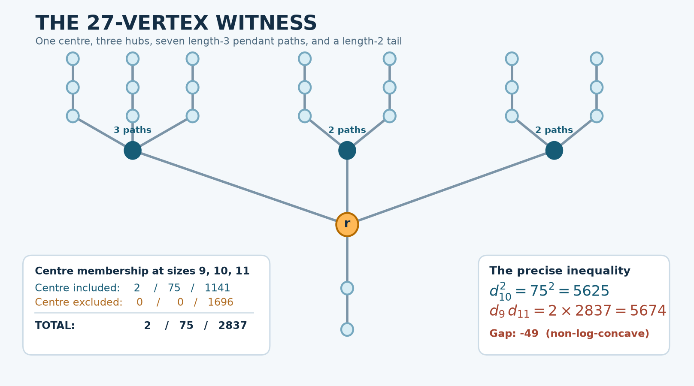

# 27정점 유일 비로그오목 나무 U의 구조와 부분집합 검산

정리 1.3(ii)(본문 6절 명제 6.5 및 정리 6.6)는 꼭짓점이 27개인 비동형 나무 751,065,460종(OEIS [A000055](https://oeis.org/A000055)) 가운데 지배다항식이 로그오목이 아닌 나무가 동형까지 유일하게 한 종류(U)뿐임을 보인다.



---

## 1. 나무 U의 정의와 부모 배열

중심 꼭짓점 v_0(번호 `0`)에 세 이웃 v_1, v_2, v_3을 연결하고, 각 v_i에 꼭짓점 3개짜리 경로(P_3)를 한쪽 끝으로 각각 2개, 2개, 3개씩 매단 25정점 나무를 T(2, 2, 3)이라 한다. 여기에 꼭짓점 2개짜리 경로(P_2) 하나를 추가하여 한쪽 끝을 v_0에 연결한 27정점 나무가 U이다.

꼭짓점 `0`을 루트로 두었을 때 꼭짓점 `1`부터 `26`까지의 부모 배열은 다음과 같다.

```text
0 1 2 3 1 5 6 1 8 9 0 11 12 13 11 15 16 0 18 19 20 18 22 23 0 25
```

불변량은 γ(U) = 9, Γ(U) = α(U) = 16, 상지배 간격 h = 7이다.

---

## 2. 2^27 부분집합 직접 열거

`computation/bruteforce_tree.cpp`는 트리 DP 점화식을 사용하지 않고 2^27 = 134,217,728개의 모든 꼭짓점 부분집합을 비트마스크로 순회하여 지배집합 개수를 직접 센다.

```sh
cd computation
c++ -O3 -std=c++17 -o bin/bruteforce_tree bruteforce_tree.cpp
./bin/bruteforce_tree 0 1 2 3 1 5 6 1 8 9 0 11 12 13 11 15 16 0 18 19 20 18 22 23 0 25
```

계산된 계수 d_0, d_1, …, d_27은 다음과 같다.

```text
0 0 0 0 0 0 0 0 0 2 75 2837 27278 132791 403364 842457 1277429 1454340 1270263 862444 458002 190138 61213 15015 2718 343 27 1
```

처음 세 양의 계수 d_9 = 2, d_10 = 75, d_11 = 2837에 대하여 지수 j = 10에서

    d_10^2 − d_9 × d_11 = 75^2 − 2 × 2837 = 5625 − 5674 = −49 < 0

이므로 로그오목성이 성립하지 않는다. 나머지 모든 지수에서는 d_j^2 ≥ d_{j-1} d_{j+1}이 성립하며, 계수열 전체는 j = 17에서 최댓값 1,454,340을 갖는 단봉 수열이다.

---

## 3. 중심 꼭짓점 포함·제외 분해 (비고 6.7)

`computation/centre_split.py`로 계산한 v_0 포함 여부에 따른 지배집합 수의 분해는 다음과 같다.

| 지배집합 크기 j | 9 | 10 | 11 |
|---|---:|---:|---:|
| v_0 ∈ S 인 지배집합 수 | 2 | 75 | 1,141 |
| v_0 ∉ S 인 지배집합 수 | 0 | 0 | 1,696 |
| 합계 d_j(U) | **2** | **75** | **2,837** |

v_0을 포함하는 지배집합만 세면 75² = 5625 ≥ 2 × 1141 = 2282로 로그오목 부등식을 만족한다. 반면 v_0을 포함하지 않는 지배집합은 최소 크기가 11이므로 d_9와 d_10에는 기여하지 않고 d_11에만 1,696을 더하여 d_9 d_11이 d_10²을 49만큼 넘게 만든다. 인접한 매개변수의 나무들과 비교하면 다음과 같다.

| 나무 | 위수 n | γ | (d_γ, d_{γ+1}, d_{γ+2}) | d_{γ+1}² − d_γ d_{γ+2} |
|---|---:|---:|---|---:|
| T(2,2,2) + P₂ | 24 | 8 | (2, 61, 1728) | +265 |
| T(2,2,3) | 25 | 8 | (1, 37, 1352) | +17 |
| **U = T(2,2,3) + P₂** | **27** | **9** | **(2, 75, 2837)** | **−49** |
| T(2,3,3) | 28 | 9 | (1, 44, 2208) | −272 |
